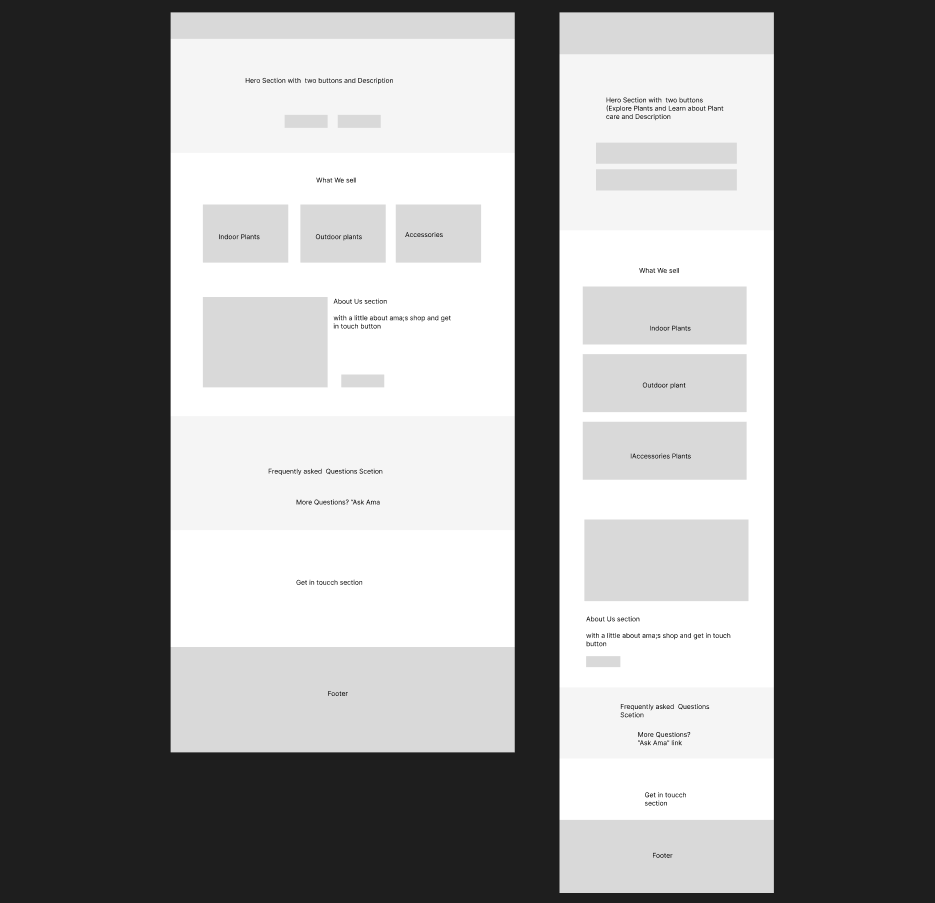

## 1. Planning

### Client and customer needs

The redesign responds to two priorities identified in the brief: customers have difficulty reading and navigating the existing site on mobile, and its visual presentation does not convey the calm, welcoming, knowledgeable character Ama wants for her plant shop.

The audience includes nearby shoppers using phones and people who are new to plant care. They need to quickly understand what Ama sells, get straightforward care guidance, and find a direct way to contact or visit the shop.

### Page sketch

[Open the Ama's Plant Corner sketch in Figma](https://www.figma.com/design/GGDLAYadqjGMbkU1E5HfmW/Ama-plant-corner-sketch-Layout?node-id=0-1&t=Vl0HJyectuqEgCjX-1). The exported desktop and mobile homepage wireframe is also included here so the design can be reviewed with the project.



### Why the content is ordered this way

The header and hero introduce the shop and give customers clear next steps. Product categories follow so shoppers can quickly see what Ama sells. The About section introduces the shop which builds familiarity and trust. The FAQ gives first-time plant owners useful information before they contact Ama. Contact and visit details remain easy to find in the lower page and footer.

The shop catalogue, product details, and extended care advice each have their own page so customers can go directly to the information they need without making the homepage unwieldy, particularly on mobile.

## 2. Pages and structure

- **Homepage - `index.html`:** Introduces the shop, links to product categories, tells customers about Ama, answers common care questions, and provides a contact form.
- **Shop - `shop.html`:** Groups the catalogue into indoor plants, outdoor plants, pots and planters, and potting soil (accessories).
- **Product details - `product-details.html`:** Provides information about each catalogue item. URL fragments such as `#indoor` select the requested detail section.
- **Plant care - `care-tips.html`:** Organizes additional care guidance by plant type.

All pages use semantic header, navigation, main, and footer regions. Sections are associated with headings using `aria-labelledby`. Product facts use definition lists, and the care disclosures use native `<details>` and `<summary>` elements.

### Visual decisions tied to the brief

The styles are split by responsibility: `css/tokens.css` contains shared design values, `css/layout.css` contains reusable page layout, `css/components.css` styles site components, and `css/styles.css` imports them and sets global defaults.

- **Colour:** Forest green (`#254B38`), sage (`#8FA68E`), warm cream (`#F8F6EF`), white surfaces, and dark text support the natural, welcoming identity in the brief.
- **Typography:** Poppins is used consistently. At the base size, h1 is `1.75rem`, h2 is `1.375rem`, h3 is `1.125rem`, body text is `1rem`, and small text is `0.875rem`. At `48em` and wider, h1 increases to `2.25rem` and h2 to `1.75rem`.
- **Spacing:** The shared scale is `--space-2xs: 0.25rem`, `--space-xs: 0.5rem`, `--space-sm: 0.75rem`, `--space-md: 1rem`, `--space-lg: 1.5rem`, `--space-xl: 2rem`, `--space-2xl: 3rem`, and `--space-3xl: 4rem`.
- **Images:** Global image rules prevent overflow; component rules set individual image sizing and cropping. Category images use `object-fit: cover` to fill their cards without distortion.
- **Responsive layout:** Base styles are designed for narrow screens. `min-width` media queries progressively adjust navigation, grids, details, and forms for wider viewports.
- **Useful actions:** Phone links use `tel:` and the footer provides a directions link, making contact and visiting more direct for local customers.

## 3. Analyse the original site

Before rebuilding, I inspected the original HTML, CSS, and rendered pages. The findings below identify the root cause, evidence, and specific effect on Ama's customers.

### Mobile usability and local access

| #   | Issue and root cause                                                                                                           | Evidence from the original website                                                                                                                                   | Impact on Ama's customers                                                                                                                                      |
| --- | ------------------------------------------------------------------------------------------------------------------------------ | -------------------------------------------------------------------------------------------------------------------------------------------------------------------- | -------------------------------------------------------------------------------------------------------------------------------------------------------------- |
| 1   | **Fixed-width layout and columns:** The page uses fixed dimensions instead of layouts that can shrink or reflow.               | `#header`, `#banner`, and `#content` use `width: 900px`; `#main` is 610px and `#sidebar` is 240px wide.                                                              | On a phone, customers may need to scroll sideways to read the page or reach shop contact details.                                                              |
| 2   | **No mobile viewport configuration:** The document does not define a viewport meta tag.                                        | The `<head>` has no `<meta name="viewport">`.                                                                                                                        | A phone may render the page at a wider virtual width and scale it down, making product information and links too small to read or tap comfortably.             |
| 3   | **Small text in important content:** Product descriptions and other key text use an 11px font size.                            | Inline `font-size: 11px` styles appear in the product introduction, About section, plant-care information, and sidebar. Product cards and footer also use 11px text. | Customers reading product details, care advice, or shop information on a phone may have difficulty without zooming in.                                         |
| 4   | **No responsive breakpoints:** The stylesheet does not adapt the layout to different screen sizes.                             | The supplied CSS contains no `@media` rules.                                                                                                                         | The navigation and product listings stay rigid on small screens, making it harder for mobile shoppers to browse the catalogue.                                 |
| 5   | **Product images do not adapt to their containers:** Images have fixed dimensions and no responsive sizing rules.              | Product images use `width="180"` and `height="120"` in the HTML, with no CSS such as `max-width: 100%`.                                                              | On narrow screens, product images may not fit their listing areas, disrupting the layout and making items harder to compare.                                   |
| 6   | **Referenced product image files are missing:** The original project does not include the image assets referenced by the page. | `index.html` references `images/houseplants.jpg`, `images/pots.jpg`, and `images/soil.jpg`, but the original project has no `images` folder.                         | Customers cannot see the houseplants, pots, or soil being offered, leaving them with less information when deciding what to ask Ama about or whether to visit. |

### Visual identity and consistency

| #   | Issue and root cause                                                                                       | Evidence from the original website                                                                                              | Impact on Ama's customers                                                                                                                                                       |
| --- | ---------------------------------------------------------------------------------------------------------- | ------------------------------------------------------------------------------------------------------------------------------- | ------------------------------------------------------------------------------------------------------------------------------------------------------------------------------- |
| 7   | **Inconsistent colour scheme:** The site uses several strong colours without a unified visual system.      | The header uses `#0066cc`, the banner `#009900`, the main button `#ff6600`, and hover states turn red.                          | Competing colours make pages and calls to action feel inconsistent, rather than supporting the calm, welcoming experience Ama wants customers to associate with her plant shop. |
| 8   | **Weak heading hierarchy:** Section headings use inconsistent semantic levels and identical styling.       | The page moves from `<h1>` to `<h4>` for sections such as "What We Sell" and "About Ama"; the CSS styles `<h4>` headings alike. | Customers scanning the page may have difficulty distinguishing sections. Skipped heading levels also make section navigation less clear for screen-reader users.                |
| 9   | **Inconsistent spacing:** Margins and padding use unrelated values rather than a consistent spacing scale. | The CSS uses values such as 4px, 5px, 8px, 10px, 12px, 15px, 20px, and 25px.                                                    | Uneven spacing can make product listings, care advice, and contact information harder for customers to scan as connected sections.                                              |

### Accessibility, content, and functionality

| #   | Issue and root cause                                                                                                                      | Evidence from the original website                                                                                                                                           | Impact on Ama's customers                                                                                                                                               |
| --- | ----------------------------------------------------------------------------------------------------------------------------------------- | ---------------------------------------------------------------------------------------------------------------------------------------------------------------------------- | ----------------------------------------------------------------------------------------------------------------------------------------------------------------------- |
| 10  | **Missing useful alternative text:** Product images have generic alt text.                                                                | All three product images use `alt="image"`.                                                                                                                                  | Screen-reader users cannot tell whether an image represents houseplants, pots, or soil, so they miss product information available to sighted customers.                |
| 11  | **Form inputs lack proper labels:** The forms rely on placeholders instead of associated `<label>` elements.                              | Inputs use placeholders such as "Your name" and "Email address" without matching labels.                                                                                     | Placeholder instructions disappear as customers type, and assistive technology may not have a reliable field name to announce while they complete an enquiry.           |
| 12  | **Plant-care topics are not implemented as clear controls:** The topics are ordinary elements rather than accessible disclosure controls. | The original page uses `<div class="guide-trigger">` and `<div class="guide-body">`; the care content is displayed rather than controlled by a semantic interactive element. | Customers may not know how to open or close a topic, and keyboard users may not be able to operate it to find Ama's care advice.                                        |
| 13  | **Duplicated enquiry forms:** Two forms offer overlapping ways to contact Ama.                                                            | The page has an "Ask Ama" form for a name and question, followed by a "Get In Touch" form for a name, email, phone, and message.                                             | Customers may be unsure which form to use, while Ama's enquiries may be split between two similar contact routes.                                                       |
| 14  | **Navigation and social links do not lead to their intended destinations.**                                                               | The menu, "Shop Now," Facebook, and Instagram links use `href="#"`.                                                                                                          | Customers cannot use these links to reach the catalogue or Ama's social media; the links remain on the current page instead of taking them to the intended destination. |
| 15  | **Neither enquiry form submits or provides a result.**                                                                                    | Both buttons use `type="button"`, and `script.js` contains no form-handling code.                                                                                            | When a customer selects "Send Question" or "Send Message," no enquiry is sent and no confirmation appears, leaving them unsure whether Ama received it.                 |

## 4. Evaluate the result against Ama's needs

The highest priorities are the defects that block a customer's core tasks: using the site on a phone, identifying products, finding the right page, and contacting or visiting Ama. The rebuild addresses many of these through responsive layouts, descriptive product content and images, working internal links, a direct phone action, and a directions link. Consistent colour, type, and spacing support the welcoming presentation in the brief.

### Verification

- I checked all four pages in a browser at viewport widths of 320px, 352px, 390px, 576px, 767px, 768px, 960px, 1088px, and 1440px. At those widths, no page had horizontal document overflow. The mobile navigation toggle appeared below 768px; horizontal navigation appeared at 768px and wider.

- I confirmed each page has a main landmark and skip link; all `aria-labelledby` references point to existing IDs; the care pages use native `<details>` and `<summary>`; and local image paths resolve.
- I tested keyboard focus on the skip link and mobile navigation. A broader screen-reader and assistive-technology audit is still recommended.

### Trade-offs and remaining limitations

- The homepage contact form has labelled, required fields and browser validation, but no configured action or server endpoint. With no `method` specified, it defaults to GET and may put submitted field values in the URL. It does not deliver messages to Ama or show a success confirmation. Do not use it for real enquiries until a submission service is configured.
- The shop category links jump to product items, but the price range and sort control are visual placeholders; they do not filter or reorder products for now, will be implemented with jvascript later.
- The focus indicator and skip link are implemented as baseline keyboard-navigation support.

## 5. Additional Improvement

### Frequently Asked Questions (FAQ) Section

As an additional improvement, I introduced a Frequently Asked Questions section using accordions.

The purpose of this feature is to help visitors, particularly first-time plant owners, find answers to common questions without having to contact Ama for every enquiry. Visitors can expand a question to read its answer and close it when they are finished.

This makes useful information easier to access, and may reduce the number of repetitive questions Ama has to answer. It also gives customers a convenient way to obtain basic information before deciding to visit or contact the shop.

## Project structure

```text
amas-plant-corner/
|-- index.html
|-- shop.html
|-- product-details.html
|-- care-tips.html
|-- css/
|   |-- styles.css
|   |-- tokens.css
|   |-- layout.css
|   `-- components.css
|-- js/
|   `-- script.js
|-- images/
|   |-- products/
|   |-- hero/
|   `-- about/
`-- Sketched.png
```

## Running locally

This site is plain HTML, CSS and JavaScript, so it needs no build step or dependencies.

### Recommended: VS Code Live Server

1. Clone or download the repository and open the folder in VS Code.
2. Install the **Live Server** extension.
3. Right-click `index.html` and choose **Open with Live Server**.
4. The site opens at `http://127.0.0.1:5500` (also reachable as `http://localhost:5500`).

Live Server reloads the page automatically when you save a file.
