# Accessibility Audit Report: Ama's Plant Corner

- **Website audited:** https://laryea-0.github.io/amas-plant-corner/
- **Date tested:** Wednesday, 18 November 2026
- **Audited by:** David Sedzro Sitsofe Kodzo
- **Accessibility standard:** WCAG 2.2, Level AA

## 1. How I Tested

The website was assessed using automated accessibility tools and manual testing methods to identify potential barriers affecting users with different accessibility needs.

### Automated testing

- **WAVE Web Accessibility Evaluation Tool:** Used to identify contrast issues, broken same-page links, structural elements, and other accessibility concerns.
- [wave.webaim.org/report#/https://laryea-0.github.io/amas-plant-corner/#shop](https://wave.webaim.org/report#/https://laryea-0.github.io/amas-plant-corner/#shop)
- **Google Lighthouse (mobile):** Used to assess accessibility and other website quality indicators.
- [pagespeed.web.dev/analysis/https-laryea-0-github-io-amas-plant-corner/2cjiswu0sl?form_factor=mobile&amp;category=performance&amp;category=accessibility&amp;category=best-practices&amp;category=seo&amp;category=agentic-browsing&amp;hl=en-US&amp;utm_source=lh-chrome-ext](https://pagespeed.web.dev/analysis/https-laryea-0-github-io-amas-plant-corner/2cjiswu0sl?form_factor=mobile&category=performance&category=accessibility&category=best-practices&category=seo&category=agentic-browsing&hl=en-US&utm_source=lh-chrome-ext)
- **NVDA screen reader**

### Manual testing

- **Keyboard navigation:** Tested interactive elements and navigation.
- **Screen reader:** Tested whether page content could be read aloud.
- **Browser zoom:** Tested the page at 200% and 400% zoom on desktop and mobile.
- **Responsive layout:** Tested the page at a viewport width of 320px.
- **Text resizing:** Observed how text sizes changed across different screen sizes.

### Pages and sections covered

- Homepage hero section
- What we sell
- About section
- Care tips
- Ask Ama form
- Footer and newsletter subscription area
- Navigation menu

## 2. Summary

The website demonstrates some positive accessibility characteristics. Its heading structure is organised, the page remains usable at 200% and 400% zoom, and the main content does not visibly overlap at a 320px viewport width. Keyboard and Screen-reader speech output also worked during the tested interactions.

However, the assessment identified several areas requiring improvement. These include low colour contrast across multiple sections, broken navigation links, a non-functioning hamburger menu, unclear newsletter subscription controls, and form fields whose required status is not communicated in advance. Some text also becomes very small on mobile devices, while the homepage hero section has spacing and positioning problems, which pushes the content away from visibilty.

The WAVE evaluation recorded 25 contrast errors, nine alerts and zero general errors. Lighthouse recorded an accessibility score of 91 on mobile. These results indicate that further accessibility improvements are necessary.

**Automated testing evidence**

WAVE overall summary showing 0 errors, 25 contrast errors, 9 alerts, and an AIM score of 4.7/10.

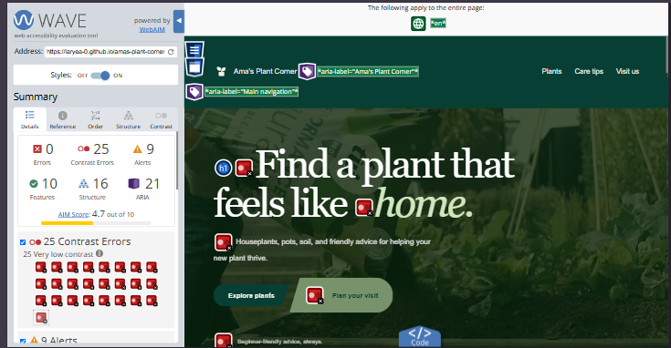

Lighthouse mobile report showing the accessibility score of 91.

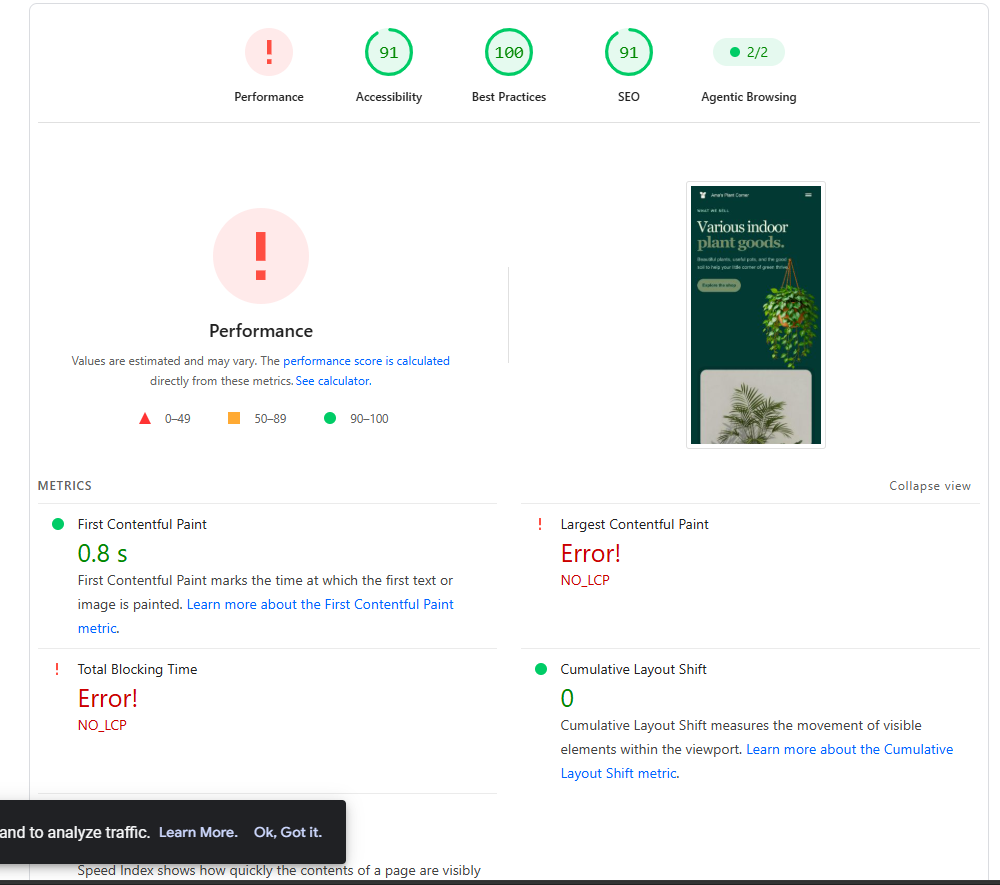

## 3. Findings, in Priority Order

The findings are ranked by the combined effect on users, how widely they affect visitors, and whether they interfere with an important task for the business. WCAG conformance level and automated-tool ratings are supporting considerations, but they do not determine the remediation order.

| Rank | Finding                                                                                    | Severity       |
| ---- | ------------------------------------------------------------------------------------------ | -------------- |
| 1    | Insufficient colour contrast                                                               | Critical       |
| 2    | Product Explore and social-media navigation links do not reach their intended destinations | Critical       |
| 3    | Mobile hamburger menu does not function                                                    | Significant    |
| 4    | Some text is too small to read comfortably on mobile devices                               | Significant    |
| 5    | Required form fields are not identified before submission                                  | Moderate       |
| 6    | Insufficient size and spacing of touch targets                                             | Moderate       |
| 7    | Newsletter subscription button does not communicate its purpose                            | Moderate       |
| 8    | Homepage hero content is positioned too low                                                | Recommendation |
| 9    | Page content stretches excessively on large screens                                        | Recommendation |

Finding 1: Text and buttons have insufficient colour contrast

- **Where:** Homepage hero section, What we sell section, About section, Care tips section, Ask Ama section and footer.
- **What happens:** Several text elements and buttons have insufficient contrast against their backgrounds, making them difficult to distinguish and read.
- **How to reproduce:**

  Adjust the foreground and background colour combinations to meet the appropriate WCAG contrast requirements. Recheck the updated colours using a contrast checker and WAVE.

- **Evidence:**

  - Hero text: 1.16:1.
  - "Plan your visit" button: 3.49:1.
  - "Explore buttons for each product in the what we sell scetion" buttons: 2.98:1.

  Text must have sufficient contrast against its background. The minimum contrast ratios are:

  - **Normal text:** 4.5:1.
  - **Large text:** 3:1.

- **Principle and criterion:** Perceivable; WCAG 2.2, Success Criterion 1.4.3, Contrast (Minimum).
- **Who it affects and how:** People with low vision, colour-vision deficiencies, and other users who have difficulty distinguishing low-contrast text may struggle to read information or identify interactive elements.
- **Found by:** WAVE and manual visual inspection.
- **Severity:** **Critical**
- **Why it ranks here:** Contrast problems occur across several sections and affect the readability of important information and controls throughout the website. The main task journey, including reading product information and identifying actions, is impaired for people with low vision or colour-vision deficiencies. The high reach and direct effect on core content justify ranking this as critical.

### Finding 2: Product Explore and social-media navigation links do not reach their intended destinations

- **Where:** Social Media Nav links, such instagram, Facebook, Whatsapp in the footer and the "Explore" buttons in the What we sell section.
- **What happens:** Some links and buttons do not take users to their intended destinations. WAVE also identified three broken same-page links where the referenced target could not be found.
- **How to reproduce:**

  1. Open the homepage.
  2. Select each "Explore" button and the social media link in the footer and What we sell section.
  3. Observe whether it takes you to the expected section.
  4. Repeat with the other navigation links and buttons.

- **Evidence:** WAVE identified three broken same-page links.

  [Insert Figure 7: WAVE alert showing the three broken same-page links.]

- **Principle and criterion:** Operable; WCAG 2.2, Success Criterion 2.4.4, Link Purpose (In Context), Level A, where the link purpose or destination is not clear. The missing anchor targets should also be documented as functional navigation defects.
- **Who it affects and how:** Keyboard users, screen-reader users and visitors relying on links to move around the page may be unable to reach the information they expect.
- **Found by:** WAVE and manual link testing.
- **Severity:** **Critical**
- **Why it ranks here:** Broken Explore buttons directly block access to expected product or section information. The finding affects a core shopping journey, and broken links prevent keyboard and screen-reader users from reaching the destination they expect.

### Finding 3: The mobile hamburger menu does not function

- **Where:** Main navigation on mobile layouts.
- **What happens:** The hamburger menu icon is visible, but selecting it does not open the navigation menu.
- **How to reproduce:**
  1. Open the website on a mobile device or narrow browser viewport.
  2. Locate the hamburger menu icon.
  3. Select the icon.
  4. Observe whether the navigation links appear.
- **Evidence:**
- **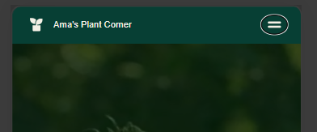 Principle and criterion:** Operable; WCAG 2.2, Success Criterion 2.1.1, Keyboard, Level A, if the menu cannot be operated using a keyboard. Also assess Success Criterion 4.1.2, Name, Role, Value, if the control does not expose its accessible name, role or state.
- **Who it affects and how:** Mobile visitors and users who depend on the navigation menu may be unable to access the website's other sections.
- **Found by:** Manual interaction testing.
- **Severity:** **Significant**
- **Why it ranks here:** The navigation menu is an important way for mobile visitors to access the website. When it does not open, users face a significant barrier to reaching other sections, although the homepage content may remain accessible by scrolling.

### Finding 4: Some text is too small to read comfortably on mobile devices

- **Where:** Footer, subscription area, form labels, product cards and other small text elements.
- **What happens:** Several text elements appear smaller than 12px on mobile devices, making them difficult to read.
- **Examples:** Subscription helper text, "Get in touch", "Keep growing with us", form labels, "Find us", "Explore" and product prices.
- **How to reproduce:**

  1. Open the website on a mobile device or set the browser viewport to a mobile width.
  2. Inspect the text in the sections listed above.
  3. Observe the rendered font sizes.

- **Evidence:** [Insert Figure 12: Mobile screenshot showing the small subscription helper text and footer have font size of 11.2px each
- **Principle and criterion:** Perceivable; WCAG 2.2, Success Criterion 1.4.4, Resize Text, Level AA, if text cannot be resized up to 200% without loss of content or functionality.
- **Who it affects and how:** People with low vision and users who have difficulty reading small text may struggle to understand product information, form labels and other supporting content.
- **Found by:** Manual visual inspection and responsive testing.
- **Severity:** **Significant**
- **Why it ranks here:** Small text affects product prices, forms, navigation support, and footer information across several parts of the mobile experience. It creates particular difficulty for people with low vision and can substantially slow down or prevent understanding of key supporting information.

### Finding 5: Required form fields are not identified before submission

- **Where:** Ask Ama form.
- **What happens:** The form does not initially indicate which fields are compulsory. A warning appears only after a user attempts to submit the form without completing a required field.
- **How to reproduce:**

  1. Open the Ask Ama form.
  2. Inspect the form fields before entering any information.
  3. Observe whether required fields are identified.
  4. Attempt to submit the form without completing the required fields.
  5. Observe the validation message.

- **Evidence:** 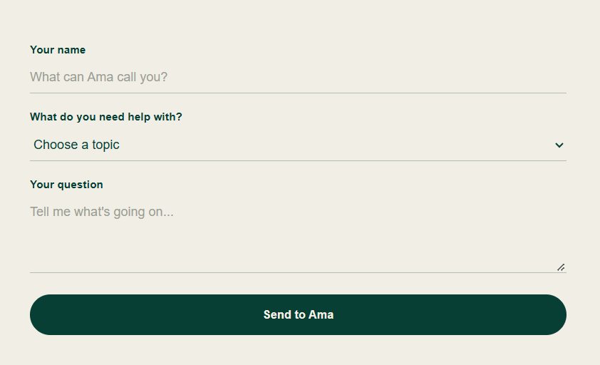

  **Principle and criterion:** Understandable; WCAG 2.2, Success Criterion 3.3.2, Labels or Instructions, Level A.

- **Who it affects and how:** Visitors, including people with cognitive disabilities, may not know which information is compulsory and may encounter avoidable submission errors.
- **Found by:** Manual form testing.
- **Severity:** **Moderate**
- **Why it ranks here:** The Ask Ama form is an important communication channel, but it remains usable. Users encounter avoidable submission errors and may not know which information is required until after submitting, creating extra effort and possible discouragement.

### Finding 6: Insufficient size and spacing of touch targets

- **Where:** Footer contact section.
- **What happens:** The telephone and email links have insufficient target size or spacing, making them difficult for users to tap accurately on mobile devices.
- **Steps to reproduce:**
  1. Open Ama's Plant Corner on a mobile device.
  2. Scroll to the "get in touch" contact section.
  3. Locate the telephone and email links.
  4. Observe the clickable areas and spacing between the links.
- **Evidence:** 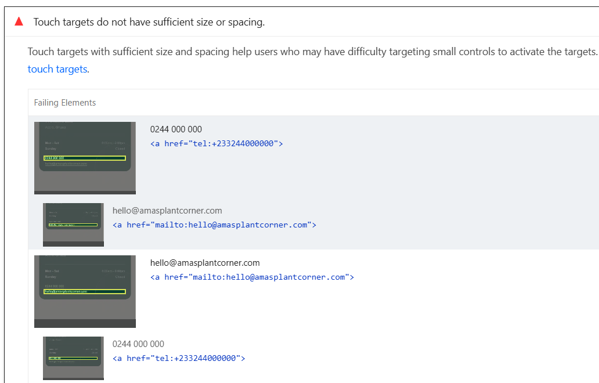
- **WCAG principle and criterion:** Operable, WCAG 2.5.8 Target Size (Minimum), Level AA.
- **Who is affected:** Mobile users, particularly people with limited hand dexterity or difficulty making precise touch movements.
- **How it was identified:** Lighthouse mobile accessibility audit.
- **Severity:** **Moderate**
- **Why it ranks here:** These links provide optional contact methods rather than the main shopping journey. They are still small and closely spaced, which can cause inaccurate taps and repeated effort for users with dexterity limitations.

### Finding 7: The newsletter subscription button does not communicate its purpose

- **Where:** Footer, newsletter subscription area.
- **What happens:** The newsletter area contains an email input and an arrow button, but the button does not visibly explain what action it performs. The surrounding content does not clearly explain the purpose of the input and button.
- **How to reproduce:**
  1. Scroll to the footer.
  2. Locate the newsletter email input.
  3. Inspect the arrow button beside it.
  4. Observe whether the control communicates that it submits an email address for newsletter subscription.
- **Evidence:**
- 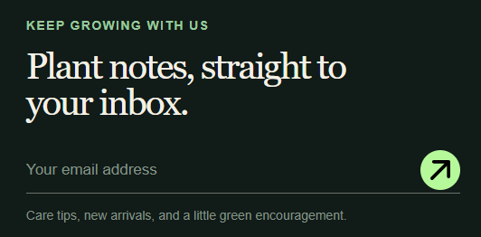
- **Principle and criterion:** Operable and Understandable; assess WCAG 2.2, Success Criterion 2.4.6, Headings and Labels, Level AA, and 4.1.2, Name, Role, Value, Level A, if the button lacks an accessible name.
- **Who it affects and how:** Screen-reader users and visitors unfamiliar with the icon may not understand the purpose of the control.
- **Found by:** Manual visual and interaction testing.
- **Severity:** **Moderate**
- **Why it ranks here:** The unclear control may prevent visitors from understanding or completing the newsletter subscription task. It is an optional extra in the footer, so it does not block shopping or contacting the shop.

### Finding 8: The homepage hero content is positioned too low

- **Where:** Homepage hero section.
- **What happens:** A large empty space appears above the main hero content, pushing the heading, introductory text and other content towards the bottom-left of the section. Some content is almost outside the visible hero area.
- **How to reproduce:**
  1. Open the homepage on a large screen.
  2. Observe the spacing at the top of the hero section.
  3. Locate the main heading and introductory content.
  4. Observe how far down the content is positioned.
- **Evidence:**
- 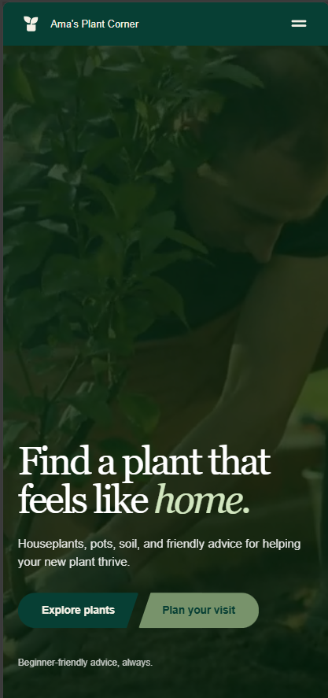 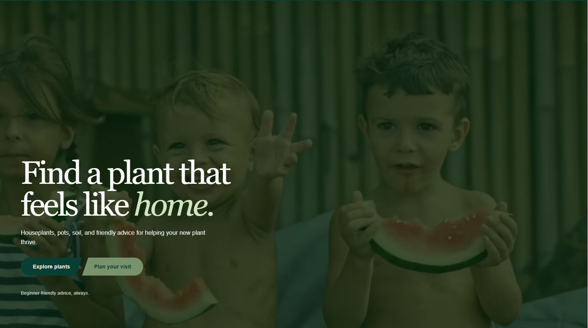
- **Principle and criterion:** This is primarily a visual layout and usability issue. Further testing is required before assigning a specific WCAG success criterion.
- **Who it affects and how:** Visitors may not immediately notice the main heading or understand what the website offers.
- **Found by:** Manual visual inspection.
- **Severity:** **Recommendation**
- **Why it ranks here:** The hero section is the first major area visitors encounter, so its layout affects their first impression and understanding of the site's purpose. The content remains available, and no visitor is completely blocked.

### Finding 9: The page content stretches excessively on large screens

- **Where:** Overall page layout on desktop and large displays.
- **What happens:** The page content stretches across large screens instead of maintaining a comfortable maximum content width.
- **How to reproduce:**
  1. Open the website on a large desktop display.
  2. Observe the width of the main content sections.
  3. Compare the content layout with the available screen width.
- **Evidence:**
  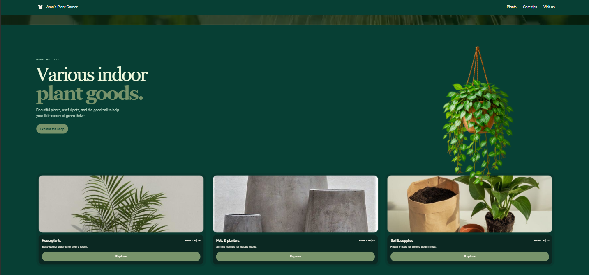
- **Principle and criterion:** Primarily a responsive design and readability concern. Further testing is required before assigning a specific WCAG success criterion.
- **Who it affects and how:** Visitors may find it harder to follow long lines of text and scan content across a wide display.
- **Found by:** Manual visual inspection.
- **Severity:** **Recommendation**
- **Why it ranks here:** The issue affects reading comfort and scanning on large screens, although it does not prevent visitors from accessing or understanding the content.

## 4. What Works Well

The following positive observations were recorded during testing:

### 4.1 Logical heading structure

The website uses a structured heading hierarchy to organise its content. WAVE identified the main heading ( from Heading one level through to level 3, main contents, footer, Aside Navigation) and the section headings, providing a useful structure for navigating the page for users of assistive technologies. They also provide semantic and visual meaning and structure to the document.

**Evidence:**

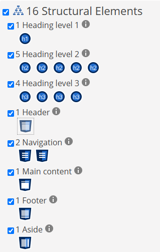

### 4.2 Screen-reader speech output and Keyboard Navigation

Screen-reader speech output worked during the tested interactions, and the content was read aloud successfully. as well all the keyboard interraction also work with verify focus visibility, focus order and operation of all interactive controls.

### 4.3 Page remains usable at 200% zoom

The page structure remained intact when zoomed to 200% on desktop and mobile devices.

### 4.4 Layout adapts to a 320px viewport

At a viewport width of 320px, the main content remained visible without noticeable overlapping.

**Evidence:** Screenshot of the website at 320px viewport width.

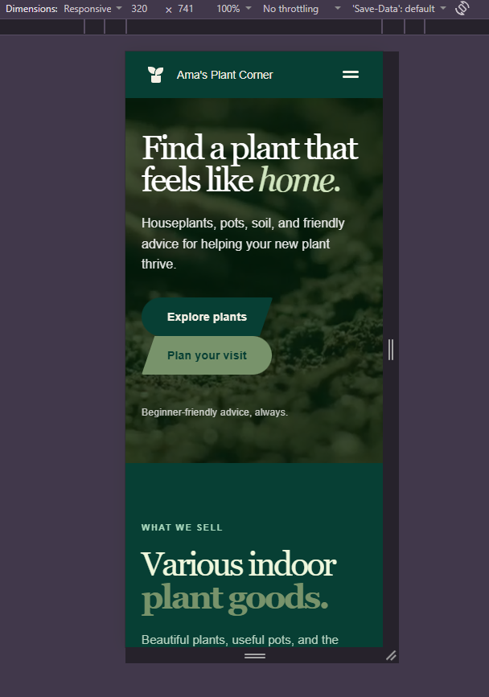

### 4.5 Responsive typography

During testing, I increased the browser text size and observed that most text resized appropriately without loss of content or functionality. This helps support users who rely on larger text for readability. However, some text elements remained relatively small on mobile devices, which could impact readability.

## 5. Not Tested and Limitations

The audit focused on the homepage and the sections listed in the testing scope. The following limitations should be considered:

- The Ask Ama form was checked for required-field instructions and validation behaviour, but it was not tested to determine whether a submitted question is delivered successfully.
- The newsletter email control was checked for purpose and accessibility, but it was not tested to determine whether a subscription is actually created or whether a confirmation email is sent.
- No live submission or account state was used, so the audit could not verify server-side validation, email delivery, or receipt of form confirmations.
- The background video in the hero section was not tested across every frame or visual condition for text contrast.
- The audit did not verify the exact contrast ratio for every automated contrast result.
- Only the homepage and listed sections were assessed. The full website was not established as conforming to WCAG 2.2 Level AA.
